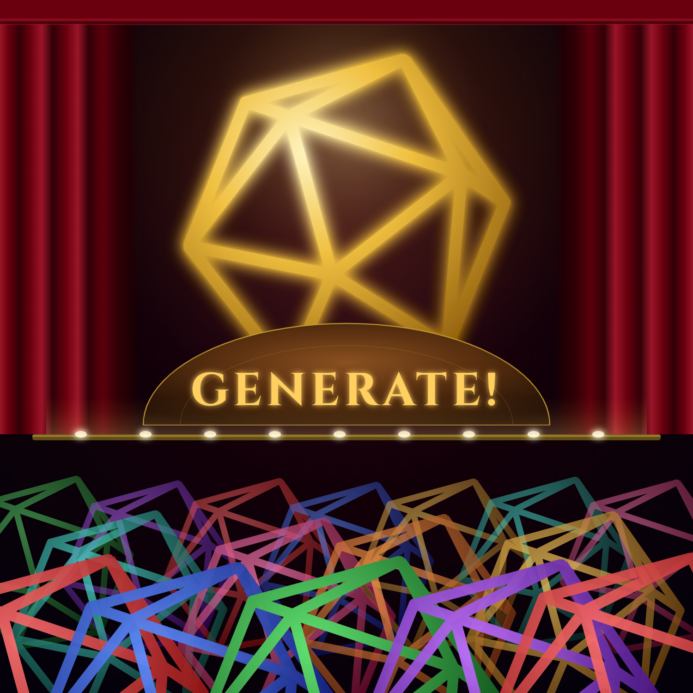

# Generate! -DnDGen.Web Theme-

[](https://suno.com/s/PLACEHOLDER)

The DnDGen.Web theme song: a royal herald fanfare, where each generator is proclaimed to the kingdom in increasingly absurd detail.
Its lyrics come from the [DnDGen.Web README](https://github.com/DnDGen/DnDGen.Web/blob/main/README.md), sung in plain English.

## Updating

This song follows the [DnDGen.Web README](https://github.com/DnDGen/DnDGen.Web/blob/main/README.md).
Every pull request that changes the README gets a song check:

1. If the change rewords or removes a phrase in the Sources table below, the song needs updating.
   The tests catch this one: they fail and list every quoted phrase that is no longer in the README.
2. Otherwise, if the change alters the README's high-level ideas or vibe, the song needs updating.
3. Otherwise, it doesn't. Changes to the README's Theme Song badge or section never need a song update.

When the song needs updating, it happens in the same pull request:

1. The contributor updates the Lyrics and Sources here to match the new README.
   Names are sung as words, never as code.
2. The maintainer makes the new song in Suno:
   - **Cover the current song**, so the theme stays recognizably the same song as it evolves.
   - Use the Title, Style, and Lyrics from this page. **Leave the Style as it is**: only the lyrics change.
   - **Turn Variety all the way down**, so Suno keeps to the Style instead of straying from it.
   - Pick the take. The new take replaces the old one.
   - **Publish it**, so anyone with the link can find and hear it.
3. The maintainer updates the Suno link here and in the README, and adds anything learned to the Suno Notes.

## Title

```
Generate! -DnDGen.Web Theme-
```

## Style

```
Royal court herald fanfare singalong, Rodgers and Hammerstein musical theatre style, bright uptempo march in 4/4, Solo herald trumpet calling out proclamations over pizzicato strings and a crisp military side-drum, answered by a massed brass ensemble of muted trumpets, trombones and French horns, Crisply enunciated delivery from a solo herald slowly losing composure as each proclamation grows more absurd, A crowd of courtiers echoing every line back with growing delight, building call-and-response throughout, The choruses grow longer and more absurdly specific with each pass, A conspiratorial bridge that drops to near-silence — just the herald and a quiet string pizzicato — before the full brass ensemble erupts louder than ever for the final chorus, Triumphant and playfully pompous, the comedy coming from great ceremony applied to increasingly technical parameter lists, Clear, regal, and deadly serious about generating everything by command of the DM
```

## Lyrics

```
[Intro - solo herald trumpet]
Hear ye! Hear ye!

[Verse 1]
Welcome to the kingdom — this page was built for thee!
Generate anything for playing D&D!
As always, getting started held the threat to be a bore:
Creating treasure, characters, and dungeons to explore!
And random encounters had the most expensive toll:
The DM often said, "A character party? Nope, reroll."

[Pre-Chorus 1]
A computer generates in SECONDS — not in hours!
ALL of the rules — every little facet — every power!
Leaving you more time for adventuring and play!
So, dear Dungeon Master, what have ye to say?

[Anticipatory drum roll]

[Chorus 1]
By command of the Dungeon Master: generate
A 20-sided die to see who's going first,
Then 4 13-sided dice, because real physics are the worst!
1-d-2 plus 3-d-4 minus 5-d-6 times 7-d-8 divided by 9-d-10!
(Who on earth would need to roll that nonsense? Just pretend!)

By command of the Dungeon Master: generate
Some Goods at level 7, or just Coin at level 3,
Or is it epic level 30 loot you want to see?
A Major suit of half-plate, Mundane sickle, or a Tool,
Or Rings or Rods or Scrolls or Wondrous Items - with all rules!

By command of the Dungeon Master: GENERATE!

[Verse 2]
All APIs run as Azure Function Apps — 6, to be exact:
Roll! Treasure! Creature! Character! Encounter! Dungeon! All intact!
Swagger UI, the authoritative reference — schemas on parade!
Request and response, parameter constraints — the whole cavalcade!
And when a page first loads, the Web BFF answers the call:
Roll, Treasure, Character, Encounter, Dungeon viewmodels — all!

[Pre-Chorus 2]
But dice and gold are trifles — Random Number Deities
Can summon forth characters and encounters, if you please!
What alignment? What class? What race? What temp? What time? What terrain?
Dungeon Master (DUNGEON MASTER!) — bring forth the refrain!

[Chorus 2 - asides worried and frantic]
By command of the Dungeon Master: generate
A character, High-level, and Any alignment's fine!
Fighter! Bard! Spellcaster - Arcane or Divine!
(But don't forget abilities, roll 4-d-6-k-3!)
(And oh, they need equipment - weapons, armor, instantly!)
Human! Elf! Non-Standard! Even monsters, if you wish!
No meta-race? Or Lycanthrope? Or Undead like a Lich!

By command of the Dungeon Master: generate
A Temperate Plains encounter — at the break of Day!
Or Cold and Underground at Night — the monsters come to play!
(You've found a rival party - before we take up arms,)
(We roll up race and spells and give them armor and guisarmes!)
Party level, creature type, allow underground or not —
3 temperatures, 9 environments — the herald likes it hot!

By command of the Dungeon Master: GENERATE! (GENERATE!)

[Bridge - conspiratorial; hushed]
... Should I even tell you this? There's 6 APIs,
But website has the generator count at only 5.
The CreatureGen has endpoints to make a foe or pet,
But there's no user interface for it yet.

[Full brass erupts]

[Verse 3]
An Angular application - well-structured, not uncouth.
Components, models, services - vitest asserts the truth.
C-Sharp in Azure Functions serves the serverless API!
Integration! Unit! Smoke! Each failure we can spy!
The GitHub build badge stands in green, displayed upon the wall —
And even THIS SONG has a test — the proudest badge of all!

[Breakdown]
But now, I must confess, I will give credit where credit is due
Tales of the Sword Coast owns the content through and through!
Oh wait, "TSR provides" is the statement that is true!
Nope, the Wizards of the Coast are the source of what we do!
No, it's Hasbro now that owns it - screw that up, and they might sue!
You know what - it's Creative Commons, so it's basically me and you!

[Pre-Chorus 3]
Roll! Treasure! Character! Encounter! What a boon!
(And creature generation will be coming very soon!)
But one more generator was forged to rule them all:
DUNGEON MASTER! The DungeonGen shall heed your mighty call!

[Final Chorus - asides losing composure]
By command of the Dungeon Master: generate
A dungeon — through a DOOR — at dungeon level 8!
(Encounter now looms, do the monsters spell doom?)
Environment is Temperate Mountains, now a HALL we shall create!
(A Wizard to fight with a Fighter for might)
A party level 3 might meet a terrible, horrible fate!
(The trap is quite grave, roll d-20 to save)
Survive the Orcs or Elementals, and booty lays in wait!
(A treasure chest hides, precious Goods are inside)
And even though it's getting quite late,
The adventurers will now debate
If more exploring is on the plate.
And maybe the level will escalate,
And maybe that fight is a heavyweight,
And TPK would infuriate - 
But have no fear! Just recreate!

By command of the Dungeon Master: 
GENERATE!
GENERATE!
GENERATE!

[Finale]
```

## Sources

| Lyric | From the README |
|---|---|
| Hear ye! Hear ye! | Not from the README: traditional herald opening |
| The website through which people can use | "the website through which people can use" |
| The dice roller! | "the dice roller (RollGen)" |
| The equipment generator! | "the equipment generator (TreasureGen)" |
| The character generator! | "the character generator (CharacterGen)" |
| The encounter generator! | "the encounter generator (EncounterGen)" |
| The dungeon generator! | "the dungeon generator (DungeonGen)" |
| All APIs run as Azure Function Apps! | "All APIs run as Azure Function Apps" |
| The Swagger UI — the authoritative reference! | "Swagger UI is the authoritative reference" |
| Generate! | "generate" (route suffix throughout the API tables) |
| Validate! | "validate" (route suffix throughout the API tables) |
| By command of the DM — generate! | Not from the README: D&D herald framing |
| Roll the dice! | Not from the README: action implied by the RollGen routes |
| An Angular single-page application! | "an Angular single-page application" |
| At DnDGen.com! | "DnDGen.com" |
| Serves the Angular app's initial data on load — | "Serves the Angular app's initial data on load" |
| The roll viewmodel! The treasure viewmodel!<br>The character viewmodel! The encounter viewmodel!<br>The dungeon viewmodel! | "RollViewModel", "TreasureViewModel", "CharacterViewModel", "EncounterViewModel", "DungeonViewModel" from the Web BFF routes |
| All ready before you even ask! | Not from the README: herald flavor |
| Character generation accepts six randomizer type params — | "Character generation accepts six randomizer type params" |
| The alignment randomizer type!<br>The class name randomizer type!<br>The level randomizer type!<br>The base race randomizer type!<br>The metarace randomizer type!<br>The abilities randomizer type! | "alignmentRandomizerType", "classNameRandomizerType", "levelRandomizerType", "baseRaceRandomizerType", "metaraceRandomizerType", "abilitiesRandomizerType" |
| Plus the set values for each! | "corresponding `set*` values for each" |
| Five of the six generators! | "five of the six generators" |
| Roll, Treasure, Character,<br>Encounter, and Dungeon! | "Roll, Treasure, Character, Encounter, and Dungeon" |
| Roll four-d-six! | Not from the README: example values for "quantity" and "die" parameters |
| Generate Goods, level five! | Not from the README: example values for "treasureType" and "level" parameters |
| Generate a character — alignment, class, level! | Not from the README: example using "alignmentRandomizerType", "classNameRandomizerType", "levelRandomizerType" |
| Six by Azure Function Apps! | "All APIs run as Azure Function Apps" (six APIs) |
| Roll the quantity on the die! | "quantity" and "die" from the RollGen route parameters |
| Validate the expression! | "validate" and "expression" from the RollGen routes |
| Generate the treasure type at level five! | "treasureType" and "level" from the TreasureGen route parameters |
| Generate the item type by power! | "itemType" and "power" from the TreasureGen route parameters |
| Generate the creature — alignment, templates, type, challenge rating! | "alignment", "templates", "type", "cr" from the CreatureGen route parameters |
| Generate the character — | "alignmentRandomizerType" and the other randomizer params from CharacterGen |
| Alignment randomizer! Class name randomizer! Level randomizer!<br>Base race randomizer! Metarace randomizer! Abilities randomizer! | "alignmentRandomizerType", "classNameRandomizerType", "levelRandomizerType", "baseRaceRandomizerType", "metaraceRandomizerType", "abilitiesRandomizerType" |
| Generate the encounter — | "temperature", "environment", "timeOfDay", "level" from EncounterGen route parameters |
| Temperature! Environment! Time of day! | "temperature", "environment", "timeOfDay" from the EncounterGen and DungeonGen route parameters |
| Level! Allow underground! | "level" and "allowUnderground" from the EncounterGen route parameters |
| Generate the dungeon through the door — | "door" route in DungeonGen |
| Dungeon level! Party level! | "dungeonLevel" and "partyLevel" from the DungeonGen route parameters |
| GENERATE! | "generate" (emphatic finale) |
| By command of the DM! | Not from the README: D&D herald flavor |

## Suno Notes

Lessons from generating this song, for the next update:

_(To be filled in after the first generation.)_

## Album Art

**Listen on [Suno](https://suno.com/s/PLACEHOLDER).**

`cover.png` will be rendered from `cover.html`, which you can open in any browser.
To render it again at 1500 × 1500, from this folder:

```
msedge --headless --hide-scrollbars --allow-file-access-from-files --window-size=1500,1500 --screenshot=cover.png cover.html
```

If Edge reads `cover.html` as a web address, pass it as a full `file:///` URL instead.
